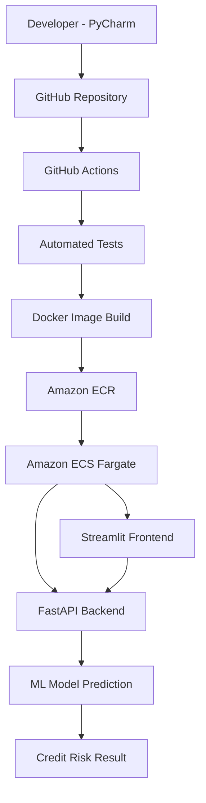
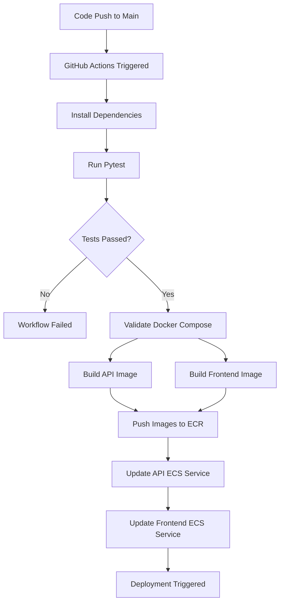

# Credit Risk Prediction – End-to-End MLOps Project

**An end-to-end Machine Learning application demonstrating model deployment, API development, containerization, CI/CD automation, and cloud deployment using AWS.**

<p align="center">
  
  
  
  
  
  
</p>

## 1. Project Overview

Credit risk assessment is an important process in banking and financial services. Financial institutions evaluate the likelihood of borrowers defaulting on their loan obligations to make informed lending decisions.

This project demonstrates how a machine learning model can be transformed into a deployable application and delivered through an automated MLOps workflow.

The application accepts customer-related financial information through a Streamlit interface, sends the input to a FastAPI backend, and generates a credit risk prediction using a trained machine learning model.

The complete application was containerized using Docker and deployed on AWS using Amazon ECS with AWS Fargate. GitHub Actions automates testing, Docker image building, publishing images to Amazon ECR, and triggering ECS deployments.

### Key highlights

- Developed an end-to-end credit risk prediction application.
- Integrated a trained ML model with a FastAPI prediction service.
- Built an interactive Streamlit frontend.
- Containerized frontend and backend separately using Docker.
- Implemented automated CI/CD using GitHub Actions.
- Stored Docker images in Amazon Elastic Container Registry (ECR).
- Deployed the application using Amazon ECS and AWS Fargate.
- Configured AWS networking, security groups, and service discovery.
- Verified the deployed application through end-to-end prediction testing.

## 2. Application Demo

**Streamlit Application – AWS Deployment Demo**

[https://drive.google.com/file/d/1AffzIaA1DvPewQrcd_YUy4iPLImULUV5/view?usp=drive_link]

The demonstration covers:
- Accessing the deployed Streamlit application.
- Entering customer information.
- Submitting a credit risk prediction request.
- Receiving the prediction results.

> Note: The AWS ECS services were stopped after successful deployment and recording of the demonstration to avoid unnecessary compute charges. The application is not currently running as a live public demo.

## 3. System Architecture

The application follows a frontend-backend architecture, with the machine learning model served through a REST API.

### Architecture diagram



### Application request flow

1. The user enters customer information in the Streamlit application.
2. Streamlit sends a prediction request to the FastAPI backend.
3. FastAPI validates the incoming request.
4. The backend loads and uses the trained machine learning model.
5. The model generates a default probability.
6. The application calculates a credit score and corresponding risk category.
7. The prediction results are returned to the Streamlit interface.

## 4. Technology Stack

| Category | Technologies |
|---|---|
| Programming language | Python 3.11 |
| Machine Learning | Trained Scikit-learn model |
| Backend | FastAPI |
| Frontend | Streamlit |
| API testing | Pytest |
| API documentation | Swagger UI |
| Containerization | Docker |
| Container orchestration | Amazon ECS |
| Container registry | Amazon ECR |
| Cloud compute | AWS Fargate |
| CI/CD | GitHub Actions |
| Service discovery | AWS Cloud Map |
| Logging | Amazon CloudWatch |
| Version control | Git and GitHub |

## 5. Machine Learning Model Integration

The project integrates a previously trained credit risk model into a production-style prediction application.

The trained model and its supporting preprocessing components are loaded by the backend.

**Model artifacts:**
- `credit_risk_model.joblib` – serialized trained model.
- Scaler – used for the relevant numerical feature transformations.
- Feature configuration – maintains the expected input feature structure.
- `cols_to_scale` – identifies columns requiring scaling.

**Prediction workflow:**

- Receive customer information through the API.
- Prepare the input features in the expected format.
- Apply the required preprocessing.
- Generate the probability of default.
- Convert the probability into a project-specific credit score.
- Assign a corresponding risk rating.

### Credit score calculation

The application uses the following project-specific scoring formula:

**Credit Score = 300 + (1 - P) × 600**

Where **P** represents the predicted probability of default.

The resulting score ranges from 300 to 900.

The application also assigns a risk category:

- Poor
- Average
- Good
- Excellent

> The score and risk categories are application-specific interpretations of the model output. They should not be treated as an officially calibrated banking credit score or an actual lending decision.

## 6. Backend Development – FastAPI

FastAPI serves as the backend prediction service and exposes REST API endpoints for communication with the Streamlit frontend.

### API endpoints

| Endpoint | Method | Purpose |
|---|---|---|
| `/` | GET | Root endpoint |
| `/health` | GET | Health check |
| `/model-info` | GET | Model information |
| `/predict` | POST | Generate credit risk prediction |

FastAPI also provides interactive API documentation through Swagger UI.

Access the documentation locally:

```text
http://localhost:8000/docs
```

### Backend responsibilities

- Load the serialized machine learning model.
- Handle incoming prediction requests.
- Validate input data.
- Perform preprocessing.
- Generate model predictions.
- Return prediction results to the frontend.
- Expose health-check and model-information endpoints.

## 7. Frontend Development – Streamlit

Streamlit provides an interactive user interface for the credit risk prediction application.

The frontend communicates with FastAPI using HTTP requests.

### Frontend responsibilities

- Collect customer-related input information.
- Send prediction requests to the backend.
- Display the prediction response.
- Present default probability, credit score, and risk category.

The backend URL is configurable through an environment variable:

```python
API_BASE_URL = os.getenv(
    "API_BASE_URL",
    "http://127.0.0.1:8000"
)
```

This allows the same frontend code to work in local development and the AWS deployment environment.

## 8. Docker Containerization

Docker was used to package the frontend and backend as separate containerized applications.

Two Dockerfiles were created:

- `Dockerfile.api` – packages the FastAPI backend and model artifacts.
- `Dockerfile.frontend` – packages the Streamlit application.

Both images use Python 3.11 slim as the base image.

### Build Docker images

```bash
docker build -f Dockerfile.api -t credit-risk-api .
```

```bash
docker build -f Dockerfile.frontend -t credit-risk-frontend .
```

### Run using Docker Compose

```bash
docker compose up --build
```

The application can then be accessed locally:

| Component | Local URL |
|---|---|
| Streamlit | http://localhost:8501 |
| FastAPI | http://localhost:8000 |
| Swagger UI | http://localhost:8000/docs |
| API Health | http://localhost:8000/health |

Docker provides consistent application environments and simplifies deployment across development and cloud infrastructure.

## 9. CI/CD Pipeline – GitHub Actions

GitHub Actions was implemented to automate the integration and deployment workflow.

The pipeline is triggered by:

- Push events to the `main` branch.
- Pull requests targeting the `main` branch.

### Continuous Integration (CI)

The following steps are performed automatically:

1. **Checkout repository:** Retrieves the latest source code.
2. **Set up Python:** Configures Python 3.11.
3. **Install dependencies:** Installs the libraries listed in `requirements.txt`.
4. **Run tests:** Executes Pytest test cases.
5. **Validate Docker Compose:** Checks the Docker Compose configuration.
6. **Build Docker images:** Builds separate FastAPI and Streamlit images.

### Continuous Deployment (CD)

For pushes to the `main` branch:

1. GitHub Actions authenticates with AWS.
2. Logs in to Amazon ECR.
3. Pushes the FastAPI image to the `credit-risk-api` repository.
4. Pushes the Streamlit image to the `credit-risk-frontend` repository.
5. Triggers a new deployment of the FastAPI ECS service.
6. Triggers a new deployment of the Streamlit ECS service.

The ECS services use the `latest` image tag, and `--force-new-deployment` instructs ECS to replace running tasks and pull the updated images.

### CI/CD workflow



### GitHub Actions configuration

Workflow file:

```text
.github/workflows/ci.yml
```

AWS credentials are configured through GitHub repository secrets rather than being hardcoded in the workflow.

Secrets used:

```text
AWS_ACCESS_KEY_ID
AWS_SECRET_ACCESS_KEY
AWS_REGION
```

The AWS region is:

```text
ap-southeast-2
```

## 10. AWS Cloud Deployment

The application was successfully deployed to AWS using Amazon ECS with AWS Fargate.

### AWS services used

| AWS Service | Implementation |
|---|---|
| Amazon ECR | Stores backend and frontend Docker images |
| Amazon ECS | Manages the application containers |
| AWS Fargate | Runs containers without managing EC2 instances |
| AWS IAM | Controls deployment and execution permissions |
| Amazon VPC | Provides networking infrastructure |
| Security Groups | Controls frontend and backend network access |
| AWS Cloud Map | Enables internal API service discovery |
| Amazon CloudWatch | Collects container logs |

### ECS deployment configuration

Two independent ECS services were created:

| Configuration | FastAPI Backend | Streamlit Frontend |
|---|---|---|
| ECS Service | `credit-risk-api-service` | `credit-risk-frontend-service` |
| Task Definition | `credit-risk-api-task` | `credit-risk-frontend-task` |
| Container Port | 8000 | 8501 |
| Launch Type | Fargate | Fargate |
| CPU | 0.5 vCPU | 0.5 vCPU |
| Memory | 1 GB | 1 GB |

### Networking and service discovery

The frontend and backend were deployed within the same VPC.

- The frontend was accessible through its public IP and port 8501.
- The backend was accessed internally by the frontend.
- AWS Cloud Map was configured for backend service discovery.
- The frontend used the internal DNS address:

```text
http://credit-risk-api.credit-risk.local:8000
```

### Security configuration

Separate security groups were configured for the two services.

**Frontend security group:**
- Allows inbound TCP traffic on port 8501.
- Allows access from the internet for the demonstration.

**Backend security group:**
- Allows inbound TCP traffic on port 8000.
- Restricts access to the frontend security group.

This avoids exposing the backend prediction API directly to the public internet.

## 11. Testing and Validation

Testing was performed at different stages of the project.

| Testing stage | Validation |
|---|---|
| Python testing | Pytest execution through GitHub Actions |
| Docker validation | Docker Compose configuration check |
| Backend testing | FastAPI health endpoint and Swagger UI |
| Frontend testing | Streamlit application access |
| Integration testing | Frontend-to-backend API communication |
| Cloud deployment testing | ECS task and service status |
| End-to-end testing | Successful credit risk prediction through the AWS-hosted application |

The complete AWS deployment was verified by accessing the Streamlit application and successfully generating predictions.

## 12. Repository Structure

The project is organized into separate frontend, backend, model, and deployment configuration components.

```text
credit-risk-project/
│
├── backend/
│   └── api.py
│
├── frontend/
│   └── app.py
│
├── model/
│   └── credit_risk_model.joblib
│
├── .github/
│   └── workflows/
│       └── ci.yml
│
├── tests/
│   └── test_api.py
│
├── Dockerfile.api
├── Dockerfile.frontend
├── compose.yaml
├── requirements.txt
└── README.md
```

## 13. Local Setup and Execution

### Prerequisites

- Python 3.11
- Git
- Docker Desktop
- Docker Compose

### Step 1: Clone the repository

```bash
git clone <YOUR_GITHUB_REPOSITORY_URL>
```

```bash
cd credit-risk-project
```

### Step 2: Create a virtual environment

```bash
python -m venv venv
```

Activate it on Windows:

```bash
venv\Scripts\activate
```

### Step 3: Install dependencies

```bash
python -m pip install --upgrade pip
pip install -r requirements.txt
```

### Step 4: Run the FastAPI backend

```bash
uvicorn backend.api:app --host 0.0.0.0 --port 8000
```

### Step 5: Run the Streamlit frontend

Open another terminal and execute:

```bash
streamlit run frontend/app.py
```

Make sure the backend is running before making prediction requests through the frontend.

Alternatively, run both services using Docker Compose:

```bash
docker compose up --build
```

## 14. Deployment and Cost Considerations

The AWS deployment was completed and tested using AWS Fargate.

To manage cloud costs, the ECS services were scaled down to zero desired tasks after the demonstration video was recorded.

The following resources and configuration were retained for future redeployment:

- ECS cluster and service configurations.
- ECS task definitions.
- Amazon ECR repositories and Docker images.
- Cloud Map service discovery configuration.
- IAM roles and deployment permissions.

## 15. Key Learnings

This project provided practical experience across the complete machine learning deployment lifecycle.

**Machine Learning deployment**
- Integrating a trained ML model into a backend prediction service.
- Serving predictions through REST APIs.
- Connecting an interactive frontend to an ML backend.

**Backend and application development**
- Building APIs using FastAPI.
- Developing an interactive interface using Streamlit.
- Configuring application communication through environment variables.

**Containerization**
- Creating separate Docker images for frontend and backend.
- Building and running containers locally.
- Using Docker Compose for application orchestration.

**MLOps and automation**
- Implementing CI/CD using GitHub Actions.
- Automating Python testing and Docker image builds.
- Publishing Docker images to Amazon ECR.
- Triggering ECS deployments automatically.

**Cloud and infrastructure**
- Deploying containerized applications using AWS ECS and Fargate.
- Configuring IAM permissions and security groups.
- Implementing internal service discovery using AWS Cloud Map.
- Monitoring application logs through CloudWatch.
- Managing cloud resources and deployment costs.

## 16. Future Improvements

Potential enhancements to make the deployment more production-ready include:

- Implement AWS IAM OIDC federation for GitHub Actions instead of long-lived access keys.
- Deploy immutable commit-specific image tags rather than relying only on `latest`.
- Add automated model evaluation and validation before deployment.
- Introduce experiment tracking and model version management.
- Implement model monitoring and data drift detection.
- Add structured logging, metrics, and alerting.
- Introduce automated integration and API contract testing.
- Configure HTTPS and a stable application URL using an appropriate load-balancing and domain setup.
- Add deployment rollback strategies.
- Implement infrastructure as code using Terraform or AWS CloudFormation.

## 17. Disclaimer

This project is developed for educational and portfolio demonstration purposes. Its predictions and risk categories are not intended to replace professional credit assessment, regulatory validation, or actual financial institution lending decisions.

---

## Author

**Bharti Kumari**

Data Science | Machine Learning | Generative AI | MLOps

[GitHub Profile](https://github.com/bhartishr28)

---

*If you find this project useful, feel free to explore the repository and connect with me.*
